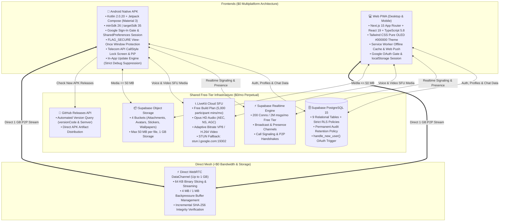
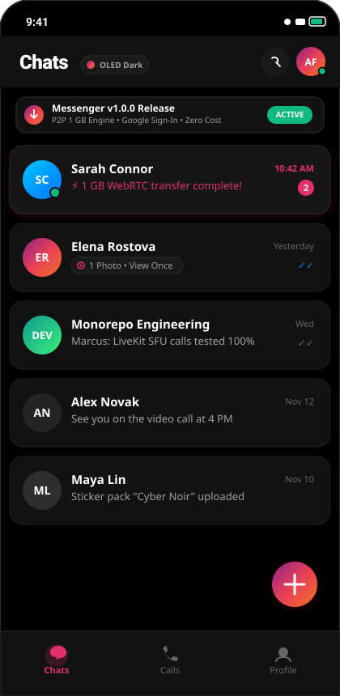
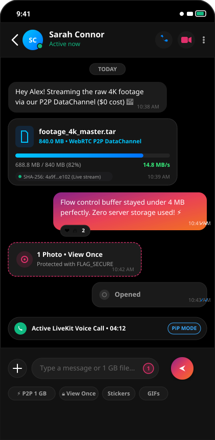
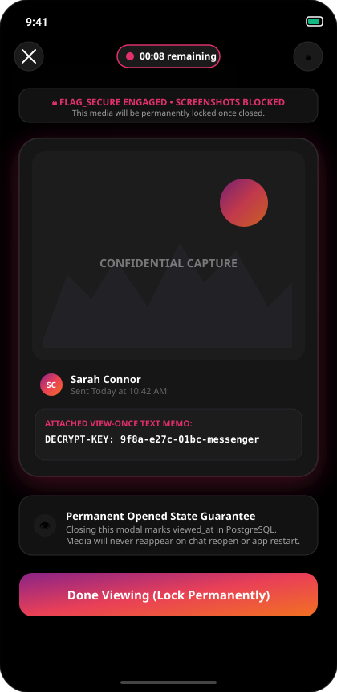
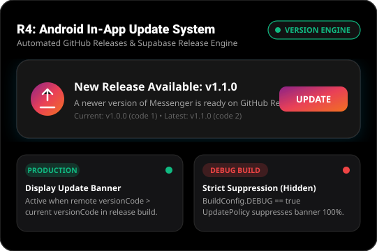
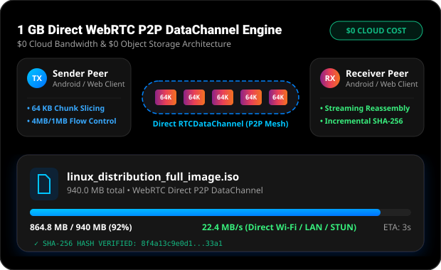

# Private Messenger ($0-Cost Multiplatform Monorepo)

<div align="center">

[](https://github.com/sreyasts/messenger/releases)
[](https://github.com/sreyasts/messenger)
[](https://kotlinlang.org/)
[](https://developer.android.com/jetpack/compose)
[](https://developer.android.com)
[](https://nextjs.org/)
[](https://react.dev/)
[](https://www.typescriptlang.org/)
[](https://supabase.com/)
[](https://livekit.io/)
[](#-p2p-1-gb-large-file-engine-0-cost)
[](#-1-zero-cost-free-tier-architecture--limits)
[](scripts/verify-e2e.js)
[](LICENSE)

**A complete, production-ready, zero-cost private messenger engineered for private groups and friends.**  
Featuring a native **Android APK** as the primary client, a matching secondary **Web PWA**, a shared **Supabase PostgreSQL** backend with strict Row-Level Security (RLS), **LiveKit Cloud** audio/video calling, and a direct **WebRTC DataChannel 1 GB P2P engine**.

[Quickstart](#-quickstart--developer-setup) • [Architecture](#-system-architecture) • [Feature Breakdown](#-feature-breakdown) • [UI Showcase](#-ui-showcase--screenshot-gallery) • [APK Releases](#-production-apk-release--download)

</div>

---

## 🏛 System Architecture

The monorepo operates on a **$0-cost perpetual free-tier model** with shared contracts across both clients:

### Visual Architectural Topology



### ASCII Architecture Matrix

```
+-----------------------------------------------------------------------------------------+
|                                    CLIENT APPLICATIONS                                  |
|   +----------------------------------------------+ +--------------------------------+   |
|   |          NATIVE ANDROID APK (Primary)        | |         WEB PWA (Secondary)    |   |
|   |  - Kotlin 2.0.20 + Jetpack Compose (M3)      | |  - Next.js 15 + React 19 + TS  |   |
|   |  - Google Sign-In Gate (AuthScreen.kt)       | |  - GoogleSignInGate.tsx        |   |
|   |  - View-Once Persistence (FLAG_SECURE)       | |  - ViewOnceModal (Text/Media)  |   |
|   |  - In-App Update Engine (UpdatePolicy.kt)    | |  - Installable Service Worker  |   |
|   +----------------------------------------------+ +--------------------------------+   |
+--------------------------------------------|--------------------------------------------+
                                             |
                   +-------------------------+-------------------------+
                   |                                                   |
                   v                                                   v
+--------------------------------------+             +------------------------------------+
|     SUPABASE FREE TIER ($0/mo)       |             |     LIVEKIT CLOUD SFU ($0/mo)      |
|  - PostgreSQL 15 (9 Tables with RLS) |             |  - 5,000 participant mins/month    |
|  - Realtime Signaling (200 conns)    |             |  - Opus HD Audio + VP8/H.264 Video |
|  - Storage Buckets (<= 50 MB/file)   |             |  - Google STUN: stun.l.google.com  |
+--------------------------------------+             +------------------------------------+
                   |
                   v (P2P Handshake Signaling via Realtime Broadcast)
+-----------------------------------------------------------------------------------------+
|                    WEBRTC DIRECT DATACHANNEL 1 GB P2P ENGINE                            |
|    Sender Client <=================================================> Receiver Client    |
|    - 64 KB Binary Chunks | 4 MB / 1 MB Backpressure Control | Incremental SHA-256 Hash  |
|    - $0 Server Bandwidth & $0 Object Storage for all files > 50 MB up to 1 GB           |
+-----------------------------------------------------------------------------------------+
```

---

## 💎 1. Zero-Cost Free-Tier Architecture & Limits

All infrastructure operates strictly within perpetual free tiers with **zero credit card requirement**:

| Subsystem | Provider & Plan | Monthly Capacity / Limits | Free Cost Safeguards & Protocols |
| :--- | :--- | :--- | :--- |
| **Database & Auth** | Supabase Free Tier | 500 MB DB storage, 50,000 MAU, Google OAuth 2.0 | Zero credit card required; indexed foreign keys & queries prevent compute spikes. |
| **Realtime Engine** | Supabase Realtime | 200 concurrent connections, 2M messages/month | Broadcast & Presence channels for typing indicators, call signaling, and WebRTC P2P handshakes. |
| **Object Storage** | Supabase Storage | 1 GB total storage | Only files ≤ 50 MB (chat attachments, View Once media, voice notes, stickers, avatars). Permanent retention. |
| **Audio/Video Calls** | LiveKit Cloud Free Build Plan | 5,000 participant mins/month, 50 GB monthly bandwidth | Free STUN fallback (`stun.l.google.com:19302`), VP8/H.264 adaptive bitrate, Opus HD audio (echo cancellation, noise suppression, AGC). |
| **P2P Large File Engine** | WebRTC DataChannel | **Up to 1 GB per file** | **$0 bandwidth & $0 storage cost**: Direct sender-to-receiver chunked binary transfer (64 KB chunks, 4 MB / 1 MB backpressure control, incremental SHA-256). |
| **In-App Update Engine** | GitHub Releases API | 60 requests/hr unauthenticated | Android checks latest tag metadata; cached client-side to minimize calls. |
| **GIF Search** | Tenor v2 / Giphy API | Free public developer tiers | Client-side query caching and offline fallback GIF library. |

---

## 🚀 Feature Breakdown

### R1. Google Sign-In & Authentication Access Gate
- **Enforced Access Gate**: Unauthenticated users are strictly blocked from viewing conversations, reading messages, or accessing composers on both platforms.
- **Android (`apps/android`)**: `AuthScreen.kt` and `AuthSessionManager.kt` using Android Credential Manager / Google Sign-In. Authenticated session persisted via `SharedPreferences`.
- **Web (`apps/web`)**: `GoogleSignInGate.tsx` wrapping the application root. Authenticated sessions persisted in `localStorage` and Supabase Auth.
- **Auto User Onboarding**: PostgreSQL trigger `handle_new_user()` on `auth.users` automatically provisions the public profile upon first sign-in.

### R2. User Profile View
- **Pure Profile Identity**: Displays user avatar, display name, description/bio, and email.
- **Zero Administrative Clutter**: Strictly excludes block user buttons, report actions, or unrequested moderation controls.
- **Clean Sign Out**: Clear, prominent Sign Out action that purges local credentials and returns to the Google Sign-In access gate.
- **Customization Options**: Global theme accent selector (5 accents), custom sticker pack manager, and chat background wallpaper picker.

### R3. View-Once Media State Persistence
- **Permanent "Opened" State**: Once opened by the recipient, view-once messages immediately transition to "Opened". The media content disappears permanently and cannot be replayed or reopened.
- **Text & Media Support**: Full support for view-once text memos, photos, and video recordings.
- **Durable Persistence**: View status is written both to Supabase (`UPDATE messages SET viewed_at = NOW()`) and client local storage (`ViewOnceStorage` on Android, `localStorage['viewed_view_once_ids']` on Web). Closing/reopening chat or restarting app **never restores** the opened media.
- **Android `FLAG_SECURE` Protection**: The Android viewer dynamically applies `WindowManager.LayoutParams.FLAG_SECURE` to prevent OS screenshots and screen recorders while viewing ephemeral media.

### R4. Android In-App Update Mechanism
- **Automated Version Checking**: `UpdateManager.kt` queries the GitHub Releases API (or Supabase release metadata) to check for newer releases.
- **Strict Debug Suppression**: Pure `UpdatePolicy.shouldShowUpdate(...)` logic strictly suppresses update alerts when running test or debug builds (`BuildConfig.DEBUG == true`), preventing interference with local testing and development.
- **Production Banner**: On production releases, if `remote.versionCode > currentVersionCode` (or semver is newer), a clean update card appears prompting the user to download the latest APK directly.

### P2P 1 GB Large File Engine ($0 Cost)
- **Direct P2P Mesh**: Files > 50 MB and up to 1 GB bypass cloud storage entirely, streaming directly peer-to-peer over WebRTC `RTCDataChannel`.
- **64 KB Chunk Streaming**: High-speed binary transmission in 65,536-byte chunks.
- **Backpressure Flow Control**: Monitors `bufferedAmount`; pauses transmission if buffer exceeds 4 MB and resumes when it drops below 1 MB.
- **Cryptographic Verification**: Computes streaming SHA-256 hashes on both ends to ensure byte-perfect transfer integrity before saving.

### LiveKit Cloud Voice & Video Calling
- **Opus HD Audio**: Automatic Echo Cancellation (AEC), Noise Suppression (NS), and Automatic Gain Control (AGC).
- **VP8 / H.264 Video**: Adaptive bitrate streaming with Picture-in-Picture (PiP) support when navigating between screens.
- **Android Telecom API Integration**: Incoming calls trigger native `CallStyle` notifications with full-screen lock screen intent, ringtone, and foreground service.

---

## 🎨 UI Showcase & Screenshot Gallery

All interfaces are designed with a **Pure OLED Black (`#000000`)** design system with elevated surfaces (`#121212`, `#1A1A1A`), subtle dividers (`#2A2A2A`), and vibrant accent highlights.

<div align="center">

### Core Screens & Features

| Front Page & Chats List | Chat Interface & 1 GB P2P Transfer |
| :---: | :---: |
|  |  |
| *OLED pure black canvas, unread counts, online status, update alerts* | *WebRTC 1 GB chunk transfer, LiveKit SFU calls, reactions, composer* |

| User Profile View | View-Once Ephemeral Modal |
| :---: | :---: |
|  |  |
| *Google OAuth badge, 5 theme accents, clean sign-out, zero block buttons* | *FLAG_SECURE window protection, countdown timer, permanent lock* |

| Android In-App Update Banner | WebRTC 1 GB P2P DataChannel Engine |
| :---: | :---: |
|  |  |
| *GitHub Releases query, production display, strict debug suppression* | *Direct mesh architecture, 64 KB chunks, 4MB/1MB backpressure, SHA-256* |

</div>

---

## 🛠 Quickstart & Developer Setup

### Prerequisites
- **Node.js**: v20.x or higher
- **JDK**: Java 17 LTS (e.g. Microsoft OpenJDK or Eclipse Temurin)
- **Android SDK**: API 26 (minSdk) to API 35 (targetSdk)
- **Git**: Installed and configured

### 1. Clone & Install Monorepo
```bash
git clone https://github.com/sreyasts/messenger.git
cd messenger

# Install dependencies across all workspaces
npm install
```

### 2. Environment Variables Configuration
Copy `.env.example` into `apps/web/.env.local`:
```bash
cp .env.example apps/web/.env.local
```

Configure your free-tier keys:
```ini
NEXT_PUBLIC_SUPABASE_URL=https://your-project.supabase.co
NEXT_PUBLIC_SUPABASE_ANON_KEY=your-supabase-anon-key
NEXT_PUBLIC_LIVEKIT_URL=wss://your-project.livekit.cloud
NEXT_PUBLIC_GOOGLE_CLIENT_ID=your-google-oauth-client-id.apps.googleusercontent.com
```
*(Note: If omitted, both frontends gracefully launch in interactive offline preview mode.)*

### 3. Run Monorepo Automated Verification Suite
```bash
# Runs full 4-tier E2E verification (75 contract tests)
npm test
```

### 4. Run & Build Web PWA (`apps/web`)
```bash
# Typecheck TypeScript codebase
npm run --prefix apps/web typecheck

# Start local Next.js development server
npm run --prefix apps/web dev

# Build production PWA package
npm run --prefix apps/web build
```

### 5. Run & Build Android APK (`apps/android`)
```bash
cd apps/android

# Run JVM Unit Tests
./gradlew testDebugUnitTest

# Assemble Debug APK (builds apps/android/app/build/outputs/apk/debug/app-debug.apk)
./gradlew assembleDebug

# Install directly to connected device or emulator
./gradlew installDebug
```

---

## 📦 Production APK Release & Download

Precompiled Android APK releases are built automatically via GitHub Actions CI/CD on every release tag:

1. Navigate to the **[Releases](https://github.com/sreyasts/messenger/releases)** tab.
2. Download the latest prebuilt APK directly: **[Messenger-v1.0.0.apk (app-debug.apk)](https://github.com/sreyasts/messenger/releases/download/v1.0.0/app-debug.apk)**.
3. Verify the file SHA-256 checksum:
   ```powershell
   Get-FileHash -Algorithm SHA256 app-debug.apk
   ```
4. Transfer to your Android device (or download directly on device) and tap to install (enable "Install unknown apps" if prompted).

---

## 📁 Monorepo Layout

```
├── .github/
│   └── workflows/
│       └── release.yml          # Automated Android APK build & GitHub release pipeline
├── apps/
│   ├── android/                 # Native Android App (Kotlin 2.0.20, Compose, Gradle)
│   │   ├── app/src/main/
│   │   │   ├── AndroidManifest.xml # Permissions, CallStyle, Share intent filters
│   │   │   └── java/com/privatemessenger/app/
│   │   │       ├── data/auth/   # AuthSessionManager.kt (Google Sign-In gate session)
│   │   │       ├── data/storage/# ViewOnceStorage.kt (Persistent viewed state)
│   │   │       ├── data/update/ # UpdatePolicy.kt & UpdateManager.kt (In-app updates)
│   │   │       ├── telecom/     # Telecom CallStyle lock screen notifications & service
│   │   │       ├── webrtc/      # WebRTC P2P DataChannel (64KB chunks, backpressure)
│   │   │       ├── work/        # WorkManager background 1 GB file transfer worker
│   │   │       └── ui/screens/  # AuthScreen, ChatsListScreen, ChatDetailScreen, ProfileScreen
│   │   └── app/src/test/        # Unit tests (UpdatePolicyTest, AndroidArchitectureTest)
│   └── web/                     # Secondary PWA Client (Next.js 15, React 19, TypeScript)
│       ├── public/              # Web app manifest, service worker, icons
│       └── src/
│           ├── app/             # App Router & API routes (LiveKit token generation)
│           ├── components/      # GoogleSignInGate, ChatsList, ChatInterface, ViewOnceModal
│           └── lib/             # Supabase client, WebRTC P2P engine, LiveKit client
├── docs/
│   ├── screenshots/             # High-fidelity OLED vector UI mockups (6 SVG assets)
│   └── testing/                 # E2E test infrastructure & readiness specifications
├── scripts/
│   ├── verify-e2e.js            # Monorepo test runner orchestrating all 5 test suites
│   ├── test-android-contracts.js# Android platform & manifest contract tests
│   ├── test-contracts.js        # Supabase schema & LiveKit token tests
│   ├── test-webrtc-streaming.js # 1 GB DataChannel chunking & flow control tests
│   ├── test-retention-security.js # View-Once & audit retention tests
│   ├── test-theme-pwa.js        # OLED theme & PWA manifest contract tests
│   ├── stress-test-livekit-edge.js # Edge function stress & load tests
│   └── generate-icons.js        # PWA maskable SVG/PNG icon generation utility
├── supabase/
│   ├── functions/livekit-token/ # Deno Edge Function for LiveKit JWT tokens
│   └── migrations/              # 9-table schema, RLS policies, triggers, storage buckets
├── .env.example                 # Environment variables template for Supabase & LiveKit
├── .gitattributes               # Cross-platform line ending normalization
├── .gitignore                   # Monorepo build artifact ignores
├── GEMINI.md                    # Single source of truth architectural contract
├── LICENSE                      # MIT Open Source License
├── package.json                 # Monorepo workspace configuration & CLI shortcuts
├── PROJECT.md                   # Feature inventory, milestone status & platform contracts
└── README.md                    # Open-source presentation & documentation (this file)
```

---

## 📄 License & Attribution

Distributed under the **MIT License**. Engineered with:
- [Next.js 15](https://nextjs.org/) & [React 19](https://react.dev/)
- [Kotlin](https://kotlinlang.org/) & [Jetpack Compose Material 3](https://developer.android.com/jetpack/compose)
- [Supabase](https://supabase.com/) & [PostgreSQL](https://www.postgresql.org/)
- [LiveKit Cloud](https://livekit.io/)
- [WebRTC](https://webrtc.org/)
